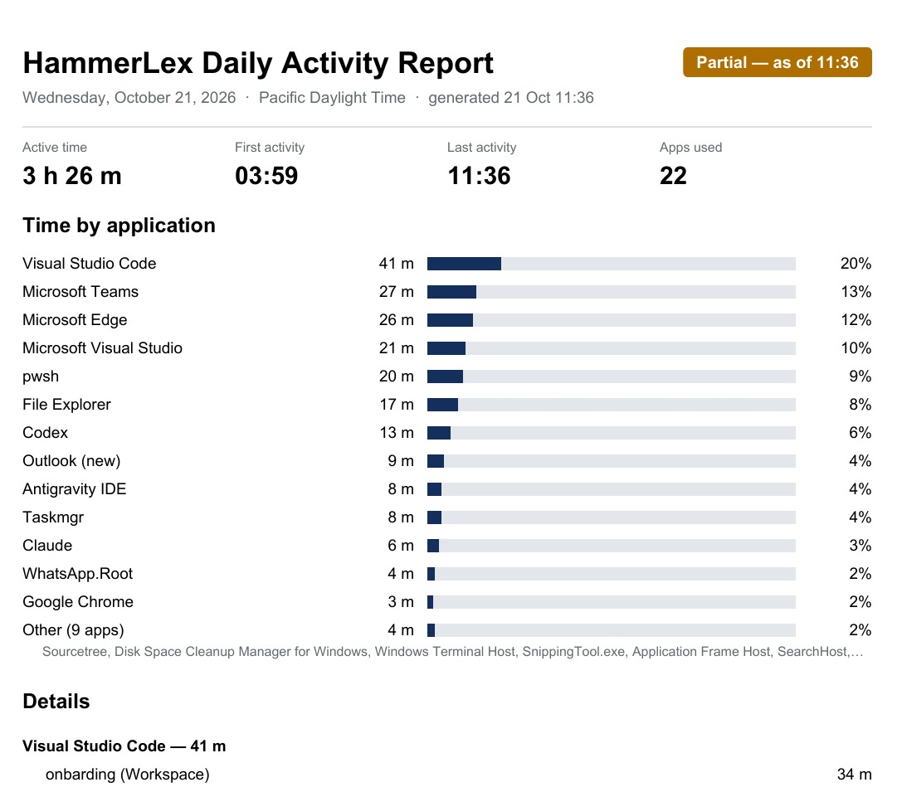

# Computer Use Time Tracking

Computer Use Time Tracking is a Windows notification-area app that records active time by application and creates daily PDF reports. Tracking data, settings, logs, and reports stay on the user's computer. The application contains no cloud synchronization, account authentication, or MCP implementation.

The app records foreground applications while the user is active, trims idle and suspended time, supports classic and new Outlook activity, and keeps pending blocks on disk when SQLite writes temporarily fail. From the tray menu, users can pause tracking, generate and open reports, change settings, view logs, or reset local data.

## Example daily report

The app generates a PDF report with a summary of active time, first and last activity, time by application, and detailed activity entries. A partial report is marked with the time it covers so readers can distinguish it from a completed day.



## Requirements

- Windows 10 version 2004 or later, or Windows 11
- .NET 10 SDK to build or run from source
- 64-bit Windows to build the provided self-contained installer
- Windows 10/11 SDK (`makeappx.exe` and `signtool.exe`) to build a signed MSIX package

## Run from source

Clone or download this repository, open PowerShell in its root directory, and run:

```powershell
dotnet restore .\ComputerUse.TimeTracking.slnx
dotnet run --project .\src\Windows\ComputerUse.TimeTracking.Windows.csproj
```

The app runs in the notification area and does not open a main window. Look in Windows' hidden-icons menu if you do not see the clock icon. Right-click it to open the menu. To open setup/settings directly:

```powershell
dotnet run --project .\src\Windows\ComputerUse.TimeTracking.Windows.csproj -- --setup
```

To build the solution and run the automated tests:

```powershell
dotnet build .\ComputerUse.TimeTracking.slnx
dotnet test ..\Shared\Core.Tests\ComputerUse.TimeTracking.Core.Tests.csproj
dotnet test .\tests\Windows.Tests\ComputerUse.TimeTracking.Windows.Tests.csproj
```

## Install the app

The repository builds an MSIX package, a Windows app installer package format. It does not include a ready-made signed installer; a maintainer must build and sign the package before Windows will install it as a trusted app. For an end-user installation, obtain the signed `.msix` or `.appinstaller` file from the person or organization distributing the app, then open it in Windows and follow the prompts. The signing certificate must be trusted on that PC, and the package publisher must match the certificate exactly.

### Build an MSIX

On a 64-bit Windows machine with the .NET 10 SDK and Windows 10/11 SDK installed, open PowerShell at the repository root. Use a four-part package version and pass the exact subject of the signing certificate as `-Publisher`:

```powershell
.\installer\build-msix.ps1 `
  -Version 1.0.0.0 `
  -Publisher "CN=Your Publisher"
```

The script publishes a self-contained `win-x64` app, stages the manifest and logo assets, builds the MSIX, and signs it using `signtool.exe`. Supply signing options through `-SignToolArgs` for the signing method in use. For a signing certificate already installed in the current user's Personal certificate store, for example:

```powershell
.\installer\build-msix.ps1 `
  -Version 1.0.0.0 `
  -Publisher "CN=Your Publisher" `
  -SignToolArgs @("/a", "/s", "My", "/n", "Your Publisher")
```

This selects a matching certificate from `CurrentUser\My`; install and select the certificate according to your organization's signing policy. For a PFX-based or trusted signing service, pass the required `signtool.exe` arguments through `-SignToolArgs`. Protect signing credentials, never commit certificates or passwords to the repository, and store CI credentials in the CI platform's secret store. The script's default timestamp URL can be overridden with `-TimestampUrl` if your signing service requires a different timestamp server.

The package is written to `src\Windows\artifacts\ComputerUse.TimeTracking_<version>_x64.msix`. If signing or packaging fails, check that the Windows SDK is installed and that `-Publisher` exactly matches the signing certificate subject. `-SkipSigning` is intended only for creating a package for inspection; Windows will not install that unsigned package as a trusted app.

To generate an `.appinstaller` file as well, provide an HTTPS feed URL where the package will be hosted:

```powershell
.\installer\build-msix.ps1 `
  -Version 1.0.0.0 `
  -Publisher "CN=Your Publisher" `
  -FeedUrl "https://downloads.example.com/time-tracker" `
  -SignToolArgs @("/a", "/s", "My", "/n", "Your Publisher")
```

The generated `.appinstaller` and MSIX are in `src\Windows\artifacts`. Publish both at the supplied HTTPS feed URL for App Installer to use. The signing certificate must remain trusted by users' PCs for installation and updates.

## Local data and reports

For the standalone app, data and logs are stored under `%LOCALAPPDATA%\ComputerUse-TimeTracking`. PDF reports are saved by default under `%USERPROFILE%\Documents\Computer Use Time Tracking Reports`. Settings let users choose a different report folder. Raw activity is retained for 60 days, generated JSON sidecars for 7 days, and PDFs remain until the user deletes them or resets local data.

See [docs/architecture.md](docs/architecture.md) for repository ownership and downstream customization.

## Support and development

For development needs or support, visit [Tateeda](https://tateeda.com). Include the Windows version, whether you ran from source or installed an MSIX, and any relevant error details when requesting help. Do not send activity database files, logs, window titles, email subjects, signing certificates, or passwords unless you have reviewed them and intentionally chosen to share them; they may contain sensitive information.

## Privacy

The application itself makes no network requests. Windows may contact an update feed when an app is installed through App Installer. Foreground window titles and email subjects can contain sensitive data; users can omit them from PDFs or exclude applications entirely.

## License

Apache License 2.0. See [LICENSE](../LICENSE) and [NOTICE](../NOTICE).
